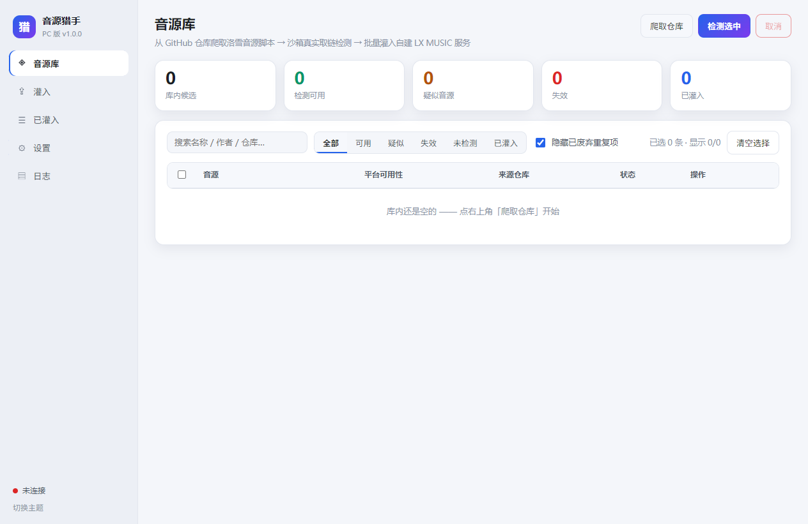
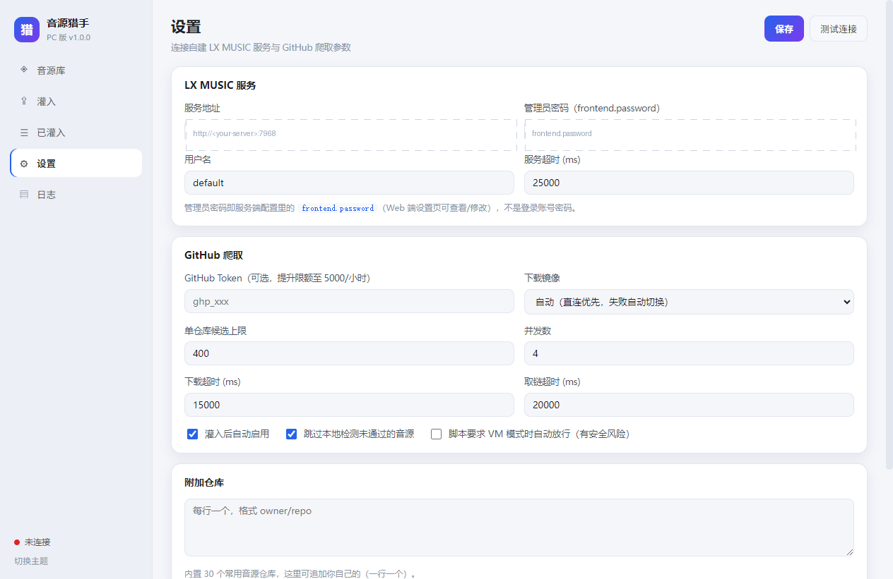

# 音源猎手 lx-hunter

> 自动从 GitHub 搜集洛雪（LX Music）音源脚本，沙箱里真实取链验证，再把能用的批量灌进你自建的 lxserver。
>
> 本仓库是 **Docker / Web 版**：浏览器打开即用，与 PC 桌面版共用同一套 `src`，功能面 1:1 对齐。零 npm 依赖，镜像基于 `node:22-alpine`。



## 它解决什么

自己维护洛雪音源，最烦的三件事：脚本散落在几十个仓库里、不知道哪个还活着、一个个手动加到服务端要命。猎手把这三步串成流水线：

| 阶段 | 做什么 |
| --- | --- |
| **爬取** | 内置 38 个仓库（可加自己的）；仓库树里的 `.js` 和 release 压缩包都扫；支持只爬近期更新的仓库，省 API 配额；下载走镜像链，网络差也能拉到 |
| **检测** | 在 Node `vm` 沙箱里跑真实取链，逐平台（酷我/酷狗/QQ/网易/咪咕…）判定可用、疑似、不可用；混淆高危与重复脚本自动打标 |
| **灌入** | 勾选后一键灌进 lxserver 并自动启用；服务端已有同名源会自动改名或标记为已灌入，不撞「已存在」 |
| **管理** | 已灌入列表、单条或批量停用、平台级开关、**公共音源清理**（只删公开源，绝不碰账号私有源） |
| **巡检** | 定时复查已灌入的音源是否还活着，失效的标出来 |

## 三分钟跑起来

```bash
docker run -d --name lx-hunter \
  -p 7971:7970 \
  -v ./data:/data \
  -e TZ=Asia/Shanghai \
  --restart unless-stopped \
  ghcr.io/zues0077/lx-hunter:latest
```

浏览器打开 `http://<宿主机IP>:7971`。冒号左边可改端口（和 NAS 上其他服务冲突时换一个，比如 `8191:7970`）。

想本地构建：`docker build -t lx-hunter . && docker run -d -p 7971:7970 -v ./data:/data lx-hunter`。
用 Compose：`docker compose up -d`（仓库里的 `docker-compose.yml` 默认本地构建，改用镜像就把 `build: .` 换成 `image: ghcr.io/zues0077/lx-hunter:latest`）。

## 配一次就能用

进「设置」页填四项，然后点 **测试连接**：

| 项 | 填什么 |
| --- | --- |
| 服务地址 | 你的自建 lxserver，形如 `http://<IP>:7968` |
| 管理员密码 | lxserver 配置里的 `frontend.password`——**不是**网页登录账号的密码，两套体系互不相通 |
| 用户名 | 决定音源**灌到哪**（见下表） |
| GitHub Token | 选填，把 API 限额从 60 次/小时提到 5000 |

**用户名 = 灌入落点**（v1.7.5 起）：

| 填 | 音源去哪 | 谁能看到 |
| --- | --- | --- |
| `default` / `open` / 留空 | 公开源（`owner=open`） | 所有账号可用，LX 网页端「音源管理」可见可管 |
| 具体账号名（如 `admin`） | 该账号的私有源列表 | 只有该账号登录后可见可用，公共列表看不到 |

删除、停用、平台开关按每条音源各自的归属路由，不会串；**公开源清理始终只删公开源**。



## 日常流程

1. **音源库** → 「爬取仓库」，拉候选脚本
2. 勾选 → 「检测选中」，沙箱里跑真实取链（每条几秒）
3. **灌入** → 「灌入全部可用」

想排除已灌入的：表头「状态」可点排序（已灌入排最后），或用「只选未灌入」一键筛。

## 数据在哪

容器内 `/data` 三个文件：`config.json`（配置）、`sources.json`（音源库）、`imported.json`（已灌入记录）。
备份或迁移 = 拷贝挂载目录；也可以网页上「导出音源库」拿 JSON，到另一台「导入」。

## PC 桌面版

不想用 Docker 的，去 [Releases](https://github.com/zues0077/lx-hunter/releases) 下 `lx-hunter-pc-*.exe`（单文件便携版，数据存在 exe 同级的 `userData` 目录，整个文件夹拷走数据不丢）。

## 自动构建

push 到 `main` 或打 `v*` 标签时，GitHub Actions 会自动构建 `linux/amd64` + `linux/arm64` 镜像并推到 GHCR（飞牛、群晖等 ARM NAS 可直接用）。PR 只构建不推送。

```bash
docker pull ghcr.io/zues0077/lx-hunter:latest     # 或 :1.7.5
```

## 安全提醒

- 音源脚本是**第三方不可信代码**：本工具在 Node `vm` 沙箱里运行，只注入洛雪的 `lx.*` polyfill，不授予文件系统和子进程权限。要求「原生 VM 模式」的脚本默认不放行，需到设置里勾选自动放行。
- 管理员密码明文存在数据卷的 `config.json` 里。别把 `/data` 提交到公开仓库，也别在不信任的机器上保存。
- 仓库源码已做脱敏：默认配置里不含任何服务地址、口令、令牌或内网路径。

## 常见问题

**检测全部失败，日志报 `xxx is not defined`？**
脚本依赖了未 polyfill 的浏览器 API，这类脚本在服务端同样跑不起来，跳过即可。

**灌入提示「已存在」？**
服务端按 `@name` 生成 id，重名会拒绝——这是保护机制。工具已自动处理：同名同内容直接标记为已灌入，同名不同内容自动改名后上传。

**GitHub 爬取报配额不足？**
设置里填一个 Personal Access Token（无需任何权限即可把限额提到 5000/小时）。

**连删多个音源后服务端卡死？**
lxserver 每次删除都会全量重载所有脚本。工具已内置保护：批删串行执行、每条之间留 5 秒间隔、遇到网络级失败立即中止。清理大批量时建议分批。

## 目录结构

```
src/core/      爬取、沙箱检测、判重、lxserver 客户端（纯 Node，PC/Docker 共用）
src/server/    Web 服务端：把桌面版 IPC 一对一映射成 HTTP 路由 + SSE 事件推送
src/renderer/  界面（桌面版与 Web 版共用同一套）
tests/         18 个单测套件 + 成品自检
```

本地开发：`npm test` 跑全部测试，`npm run test:dist` 校验打包产物，`npm run start:web` 起 Web 版。

## 许可

GPL-3.0。详见 [LICENSE](LICENSE)。
